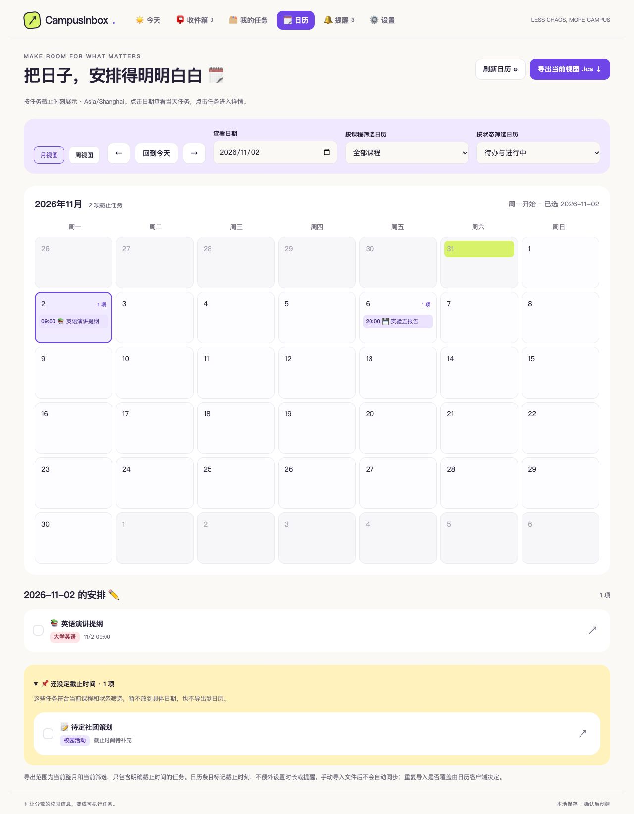
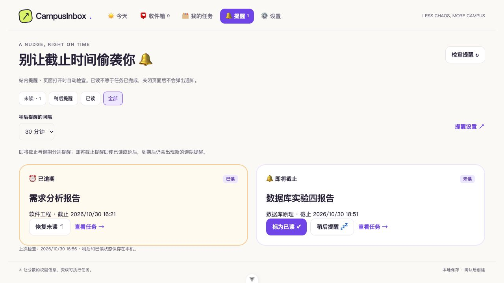

# CampusInbox

让分散的校园信息，自动变成可执行任务。

面向大学生、本地运行的校园任务工具。通过“我的任务 → 新建任务”粘贴通知、上传图片／文件或手动填写。通知经 **文本提取与校正 → 规则优先识别 / 可选本地／API 模型兜底 → 收件箱审核 → 创建或更新任务 → 查看来源与历史**；手动填写可直接保存。

## Windows 本地采集扩展

本次新增的 `local-assistant/` 提供独立的 Windows 桌面登录、学习通采集、手机连接及本地任务管理。使用方式见[扩展快速开始](local-assistant/README.md)，接入范围见[整合说明](docs/local-assistant.md)。

两套程序使用不同 API 和数据库，任务不会自动同步。下文介绍仓库原有 FastAPI 应用；运行扩展请先进入 `local-assistant/`。

开发状态与后续安排见 [开发进度与后续计划](docs/progress.md)，包含已实现功能、待办事项及「设置 → 数据源连接」的 Connector 规划。

## 已可使用

- ☀️ 首页：真实待办、完成进度、未来七天的截止任务和待处理建议。
- 📮 收件箱：保存原文与实际发送时间，查看识别依据，编辑建议后确认；支持忽略、恢复和重新识别。
- 🗂️ 任务：手动创建、编辑、完成、取消、归档与恢复，按课程 / 状态筛选、搜索，查看原文和操作记录。
- 📎 统一新建：文本粘贴、图片上传、文件上传与手动填写。TXT / Markdown 本地读取；图片、PDF、Word、PPT 经确认后发送到 MinerU 云端解析，需配置 Token。保留原文件，提取文本可校正，解析记录可恢复。
- ⚙️ 模型设置：可切换本地 Ollama／用户填写的兼容 API，提供连接测试、系统安全凭据存储和每日调用上限；无模型也能使用规则与人工审核。
- 🗓️ 截止时间变更：延期 / 提前通知匹配原任务，预览新旧时间后确认更新，支持刷新后撤销；保留多条通知与完整历史。
- 📌 取消通知：匹配原任务、预览状态变化、确认取消、持久撤销，保留原任务内容和多条来源。
- 🧩 多任务通知：连续编号条目生成独立草稿，逐项编辑、保存、确认或跳过，共享完整原文，处理进度可恢复。
- 🔗 重复通知：可关联原任务，比较差异并勾选补充字段；默认保留原值，确认后保留来源，支持持久撤销。普通通知与拆分条目均可用。
- 🔔 站内截止提醒：即将截止 / 逾期列表、未读数量、提前时间设置、已读与稍后提醒；自动跟随任务最新状态和截止时间。
- 🗓️ 截止日历：周 / 月视图、课程 / 状态筛选、当天安排与待定日期任务；可导出当前视图为 `.ics` 文件。
- SQLite 本地持久化；重复导入去重、重复确认防重，版本检查防止编辑覆盖。完成与归档后的即时撤销会记录为新操作。

**采用保守模式：创建任务、截止时间变更与取消都必须确认。** 明确的延期 / 提前 / 时间调整通知可以选择已有任务并预览后更新；明确的单任务取消通知也可预览后确认；编号多任务可逐项审核创建；未编号多任务及其他要求变更仍只提示人工核对。预览过期时拒绝覆盖；更新后又有其他编辑时拒绝直接撤销。

尚未实现日历自动同步、系统提醒推送、微信 / 学习通主应用自动同步、自动任务合并、备份恢复和安装包。MinerU 云端文档解析已接入，并通过合成 PNG 与 PDF 的真实 API 闭环测试；其他文件格式仍需逐项验收。QQ 接入范围及验收边界见下文。

## 界面预览

截图使用合成测试数据，仓库不包含个人通知或本地数据库。



<details>
<summary>查看站内提醒界面</summary>



</details>

## 快速开始

准备 Git、uv 和 Node.js 24 LTS，在仓库根目录执行：

```bash
uv python install 3.11
uv run --python 3.11 scripts/setup.py
uv run --python 3.11 scripts/dev.py
```

打开 `http://127.0.0.1:5173`；API 文档在 `http://127.0.0.1:8000/docs`。Ctrl+C 停止两端服务。

首次没有演示任务。进入“我的任务 → 新建任务”，可粘贴真实通知或选择“试填一条示例通知”，核对原消息发送时间，整理并审核后创建任务。也可选择图片／文件上传，或手动填写直接保存。刷新或重启后仍保留。

图片和 PDF / Word / PPT 使用 MinerU 官方精准解析 API。在 `backend/.env` 中填写 `MINERU_API_KEY=你的Token`（Token 在 [MinerU API 管理](https://mineru.net/apiManage) 创建）。每次上传前需确认发送到 MinerU；Token 只由后端读取，不发送到浏览器或写入数据库。TXT / Markdown 文件在本机读取，不需要 Token。单文件上限 20 MB，提取文本校正为不超过 20000 字后再提交审核。详见[统一新建与附件解析](docs/task-import.md)。

PyCharm 可直接运行 **Dev (frontend + backend)**；解释器选择 `backend/.venv/bin/python`。Windows 对应 `backend/.venv/Scripts/python.exe`。

## 测试一次延期更新

1. 先创建“实验四报告”，课程填“数据库原理”，设置一个截止时间。
2. 导入：“数据库原理：实验四报告延期到下周一晚上八点，其他要求不变。”
3. 在收件箱核对候选任务，点击“预览这次变更”，比较新旧时间，再确认更新。
4. 到任务详情查看两条来源与历史；刷新后仍可撤销本次截止时间更新。

原任务只有一条，标题、提交要求和状态不会被延期通知覆盖。多个候选需要用户选择；没有明确时刻则手动填写。

## 测试一次取消通知

创建“数据库原理”的“实验四报告”后，导入“数据库原理：实验四报告取消，不用再提交。”。在收件箱选择任务、预览后确认。任务标记为已取消；到详情可撤销本次取消，恢复原状态。

“是否取消”“取消延期”“无需提交纸质版”等表述不进入取消预览。取消后又编辑过任务时，旧撤销会拒绝覆盖；请核对历史后手动调整。

## 测试一次多任务通知

导入以下内容，点击“生成拆分草稿”，分别核对并确认两项。未确认的草稿不会变成正式任务。

```text
软件工程：
1. 下周一晚上八点前提交需求分析报告。
2. 下周三下午六点前提交原型设计，上传至学习通。
```

支持每项另起一行、从 1 开始连续编号的 2–20 项。可保存草稿后刷新继续；跳过的条目可恢复。公共说明请对照原文核对，不会把某项的平台或时间自动套用给其他项。

## 测试一次重复通知关联

先手动创建“软件工程”的“需求分析报告”，截止时间设为 11 月 2 日 20:00，不填写提交平台。然后导入：

```text
软件工程：11月4日下午六点前提交需求分析报告，上传至学习通，文件命名为学号+姓名。
```

在收件箱选择“关联已有任务”，默认不勾选任何字段。只勾选提交平台和文件要求，预览后确认：任务仍为原来的一条，截止时间保持原值，平台 / 文件要求得到补充。到详情查看两条来源，刷新后仍可撤销本次关联与补充。相对或省略年份的日期仍以实际消息发送时间解析，测试时请核对年份。

也可以不勾选字段，只关联通知来源。多个相似任务要手动选择；已经创建的两条任务归并留到后续。

## 测试一次截止提醒

新建一个任务，把截止时间设为未来一小时，保持待办。进入导航“提醒”，即可看到即将截止卡片。可以标为已读、稍后提醒或恢复未读，刷新后保留；完成任务后提醒消失。

“设置”里可选择提前多久提醒、是否显示逾期提醒。默认提前一天。**目前只做站内提醒：页面打开时约每 30 秒检查，关闭页面后不会弹系统通知。** 详见提醒文档。

## 查看截止日历与导出

进入导航“日历”，切换周 / 月，选择课程、状态和日期。点击日期查看当天安排，点击任务进入详情；没有截止时间的任务单独列出。

点击“导出当前视图 .ics”下载当前整月 / 整周与当前筛选的截止任务，可手动导入日历。文件按截止时刻标记任务，没有额外设置时长或提醒，也不会自动同步；重复导入是否覆盖取决于日历客户端。详见 [截止日历文档](docs/calendar.md)。

## QQ 接入核心（适配器待接入）

「设置 → 数据源连接 → QQ」已提供账号、群与指定成员检测范围、状态和队列管理。平台无关核心已连接原收件箱，并提供本机 OneBot HTTP 适配器和 macOS 钥匙串配置；本机已验证真实 QQ 登录、群／成员目录和指定成员文本通知进入收件箱，进程重启可恢复会话与检测范围；长期运行、媒体、完整离线补拉和 Windows 凭据存储仍待验收。详见 [QQ 核心与适配器契约](docs/qq-core.md) 和 [Mac 接入步骤](docs/qq-mac.md)。

## 本地／API 模型（可选）

先安装并启动 Ollama，再安装符合本机资源的本地模型。建议启动服务时禁用 Ollama 云端功能：

```bash
OLLAMA_NO_CLOUD=1 ollama serve
```

Windows PowerShell：`$env:OLLAMA_NO_CLOUD="1"; ollama serve`。如果已通过 Ollama 应用运行服务，请先确认该服务的本地模式配置，避免重复启动。

进入“设置”测试连接、选择本机已安装的模型、启用兜底并保存。模型名按实际安装列表填写；本项目不会自动下载权重。Provider 会排除云模型并检查本地模型元数据；不认识的模型保留规则结果供人工审核。

通知不明确时才调用模型；结构化输出仍要经过来源校验，不会直接写入任务。服务未启动、超时或输出无效时保留原文与规则字段。实际模型效果和速度取决于所用模型、机器和通知内容。

也可以进入「设置 → 通知识别 → API 模型」，填写兼容 Chat Completions 的基础地址、Model ID 和 API Key，确认数据发送及费用后测试并保存。密钥只保存在本机系统凭据存储，不回显、不写入数据库或 Git；本地与 API 不自动互相降级。详见 [模型 API 使用说明](docs/model-api.md)。

## 数据与隐私

默认数据库为 `backend/data/campus-inbox.db`，并使用 SQLite WAL 文件。数据库、模型权重、个人消息和凭据均不提交 Git。关闭服务后再迁移整个 data 目录，避免遗漏 WAL 数据；当前没有图形备份功能。

仅供本机单用户使用，服务绑定 `127.0.0.1`。没有登录鉴权，不应将端口暴露给局域网或公网。本地模型只允许回环地址的 Ollama；用户主动启用 API 后，识别所需内容会发送给指定服务，服务商的留存策略需用户自行确认。MinerU 的文档解析 Token 独立保存在环境变量或 `backend/.env`，原始附件保存在数据库旁的 `uploads/` 目录。备份或迁移时需同时保留数据库目录和附件。

测试可通过 `CAMPUSINBOX_DB_PATH` 指向独立数据库，不污染实际使用数据。原始通知不可直接删除；任务“删除”采用可恢复归档。

## 开发与验证

```bash
uv run --python 3.11 scripts/check.py
```

包含后端 Ruff / pytest 和前端 lint / 格式 / 日期计算测试 / TypeScript / 生产构建。测试使用临时 SQLite 和模型模拟响应，不会将消息发给真实模型。真实模型效果评测尚未开展。

- [第一阶段范围、模型与 API](docs/mvp.md)
- [截止时间审核设计与 API](docs/deadline-review.md)
- [取消通知审核设计与 API](docs/cancellation-review.md)
- [多任务拆分审核与数据库升级](docs/multi-task-review.md)
- [重复通知关联与字段合并](docs/notice-merging.md)
- [站内截止提醒](docs/reminders.md)
- [截止日历与 iCalendar 导出](docs/calendar.md)
- [Windows QQ 开发与 AI Chat 交接指南](docs/windows-qq-development.md)
- [开发与故障排查](docs/development.md)
- [本阶段验证记录](docs/verification.md)

```text
frontend/    Vue 3 + TypeScript + Vite 网页端
backend/     FastAPI + SQLModel API、SQLite 与后端测试
scripts/     安装、启动与检查
benchmarks/  后续模型效果评测
.github/     CI、Dependabot、Issue / PR 模板
```

项目目前处于早期开发阶段，已在 macOS Apple Silicon 验证。Windows / Linux 独立机器安装、完整模型准确率评测和安装包仍待后续验收。

许可证尚未确定，当前没有添加 LICENSE。请在报告问题或提交改动时使用合成 / 脱敏示例，避免提交真实通知、账户信息或凭据。
